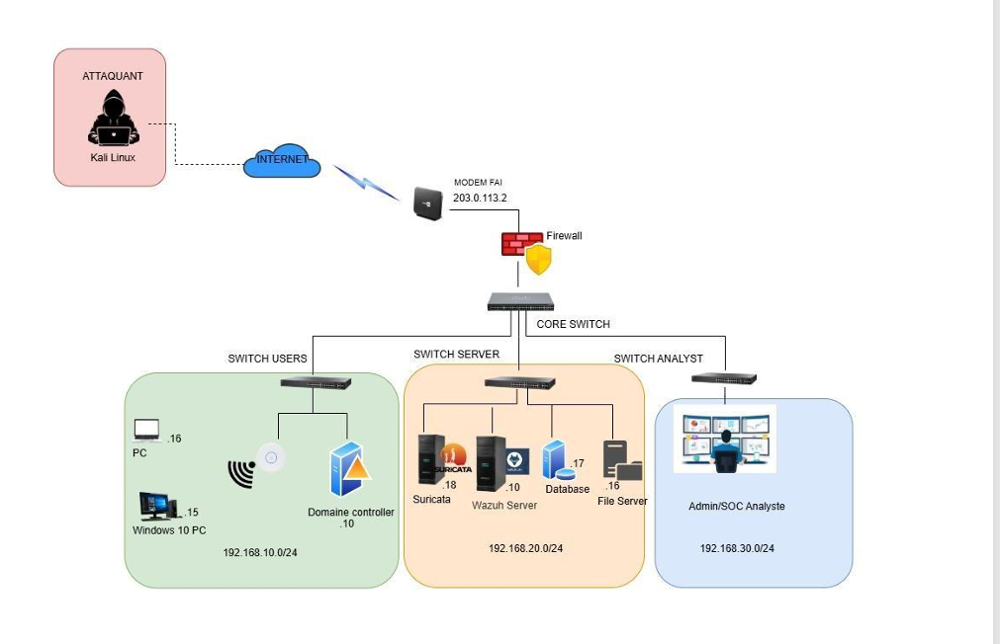

# 🛡️ Détection et réponse aux incidents avec Wazuh & Suricata

## 📌 Présentation du projet

Ce projet, réalisé dans le cadre de mon mémoire de fin de formation en cybersécurité, porte sur la conception et le déploiement d'une solution de détection et de réponse aux incidents de sécurité au sein d'un environnement réseau d'entreprise simulé.

L'approche repose sur l'intégration de deux solutions open source complémentaires :

- **Wazuh** : supervision des hôtes, centralisation et analyse des événements de sécurité.
- **Suricata** : inspection du trafic réseau et détection des activités suspectes.

L'objectif est de renforcer la visibilité sur les événements de sécurité en combinant la surveillance des systèmes et l'analyse du trafic réseau.

---

## 🎯 Objectifs du projet

- Concevoir une architecture réseau adaptée à la supervision de sécurité.
- Déployer et configurer Wazuh et Suricata.
- Centraliser les événements des hôtes et les alertes réseau.
- Simuler des activités suspectes dans un environnement contrôlé.
- Analyser les alertes remontées dans Wazuh.
- Mettre en œuvre et tester des mécanismes de réponse automatisée.

---

## 🏗️ Architecture de déploiement

L'environnement de test repose sur une infrastructure réseau segmentée comprenant des postes utilisateurs, des serveurs, un réseau d'administration et une machine dédiée aux simulations d'attaques.

La plateforme Wazuh centralise les événements des agents et les alertes réseau produites par Suricata.

---

## 🛠️ Technologies utilisées

| Technologie | Rôle dans le projet |
|---|---|
| **Wazuh** | Centralisation, analyse et supervision des événements |
| **Suricata** | Détection des intrusions réseau |
| **Ubuntu Server** | Hébergement des composants de sécurité |
| **Windows / Windows Server** | Systèmes supervisés |
| **Kali Linux** | Génération du trafic de test |
| **Nmap / Hydra / hping3** | Simulation d'activités suspectes |
| **MITRE ATT&CK** | Référentiel d'analyse des comportements |
| **JSON** | Format des événements Suricata intégrés à Wazuh |

---

## ⚙️ Réalisations techniques

Le projet a permis de documenter :

- Le déploiement et la configuration de Suricata.
- L'installation de la plateforme Wazuh et de ses agents.
- L'intégration des journaux `eve.json` de Suricata dans Wazuh.
- La centralisation des alertes réseau et des événements système.
- L'exécution de scénarios de détection : scans réseau, trafic DoS simulé et tentatives de connexion SSH.
- La surveillance de l'intégrité des fichiers.
- La configuration et les tests de mécanismes de réponse active.

---

## ✅ Résultats obtenus

Les expérimentations documentées ont notamment montré :

- La remontée d'alertes Suricata dans la console Wazuh.
- La détection d'activités réseau suspectes.
- L'identification d'échecs d'authentification SSH.
- L'exécution de mécanismes de réponse automatique.
- Le blocage temporaire d'une source de trafic lors d'un scénario de test.

Ces résultats ont été observés dans l'environnement de laboratoire présenté dans le mémoire.

---

## 📄 Documentation technique

Le document technique présente l'architecture, les configurations réalisées, les captures d'écran et les scénarios de validation.

📘 [Consulter la documentation technique](Documentation-technique.pdf)

---

**KABIR IT | Réseaux • Systèmes • Cybersécurité • Sécurité défensive**
